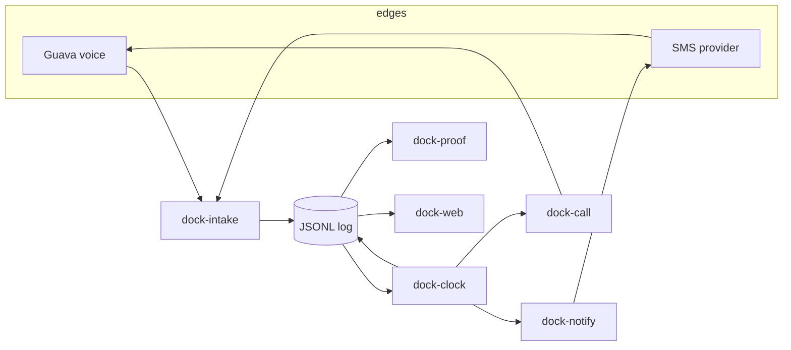
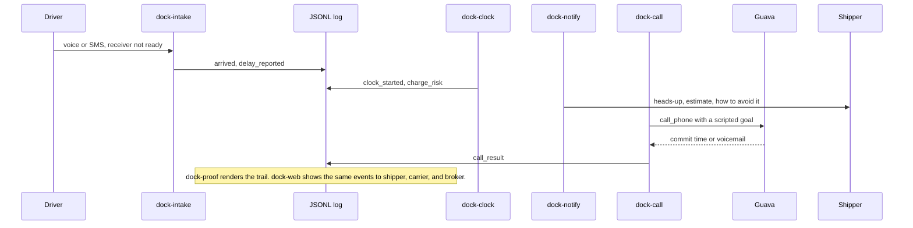

# Architecture

Dock is a set of filters over one event log. Voice and SMS are edges. Money is a pure function of events and a policy. The web page is a view.





## Pipe contract

Every filter reads JSONL on stdin and writes JSONL on stdout. Human notes go to stderr. A document a person reads goes to `--out` or to `--print`, so it does not poison the next filter.

Consumers sort by `occurred_at`. File order is write order. A `notice_sent` line is often appended after later facts and still belongs next to the `charge_risk` it cites, because both share `occurred_at`.

`dock-clock` ignores facts with `occurred_at` after `--as-of` and leaves them out of stdout. stderr says how many lines it held back. That is what makes "jump the demo clock" and the pipe the same function.

```bash
uv run dock-events cat data/samples/harbor-rye.raw.jsonl \
  | uv run dock-clock --replay --as-of 2026-10-17T22:05:00Z \
  | uv run dock-notify \
  | uv run dock-proof --load LL-88421 --out data/runtime/LL-88421-trail.md
```

`--replay` folds `tick` across the checkpoints: clock start, warning, a mid-accrual snapshot one billing step after free time, and the stop. A single `--as-of` without `--replay` emits only the snapshot for that instant. Use the single shot when a scheduler is asking "what is true right now." Use replay when you are building the trail.

`dock-events append PATH` writes stdin onto a file, skips duplicate `event_id`s, and takes an exclusive lock. It does not rewrite earlier lines.

## Event envelope

Schema version 1. `dock-events schema` prints a JSON Schema. The enforcing code is `dock_events.model`. Unknown event types are rejected. Unknown payload keys are allowed. Required payload keys are not.

| Field | Meaning |
| --- | --- |
| `schema_version` | `1` |
| `event_id` | 8 to 80 characters, `[A-Za-z0-9_-]`. Immutable identity. |
| `type` | One of the types below. |
| `occurred_at` | When the fact happened. UTC, trailing `Z`. |
| `recorded_at` | When this line was written. UTC, trailing `Z`. |
| `load_id` | The freight bill this line is about. |
| `actor` | `role`, `party_id`, `channel`. |
| `payload` | Type-specific object. |
| `caused_by` | Another `event_id`, or null. |
| `source` | Which module wrote it: `sample`, `dock-intake`, `dock-clock`, `dock-notify`, `dock-call`, `dock-proof`, `dock-track`. |

Roles: `driver`, `shipper`, `consignee`, `broker`, `carrier`, `system`.

Channels: `voice`, `sms`, `web`, `system`, `cli`.

Money is a string with two decimals (`"56.25"`), never a JSON float. Phone numbers are E.164.

### Types

| Type | Who writes it | Required payload |
| --- | --- | --- |
| `arrived` | intake or sample | Facility, appointment, timezone, reference, commodity, lane, driver, carrier, shipper, consignee, broker, truck, phones |
| `delay_reported` | intake or sample | `reason`, `detail` |
| `unload_started` | intake or sample | `door` |
| `unload_done` | intake or sample | `door` |
| `clock_started` | dock-clock | Start, free-time end, free minutes, anchor, rate, step, `stop_on` |
| `charge_risk` | dock-clock | `phase` (`warning`, `accruing`, `closed`), elapsed, remaining, billable minutes, estimate, `how_to_avoid` |
| `notice_sent` | dock-notify | Channel, who, body, estimate, phase |
| `call_result` | sample or dock-call | Goal, outcome, who, summary |
| `claim_drafted` | dock-proof | Title, markdown, estimate |
| `tracking_requested` | dock-track | `intent`, `summary`. Extra keys may carry the caller role, identifiers, a condition, and `same_instructions` |

`arrived` carries a snapshot of the parties so later modules do not join a database. `shipper_contact` and `consignee_contact` are optional extra keys the sample uses so a heads-up can name Dan and Priya. The required name fields stay the company names, which is what the proof pack prints under Parties.

Call outcomes: `reached`, `voicemail`, `no_answer`, `wrong_person`, `dry_run`.

A short fact, from the sample:

```json
{
  "schema_version": 1,
  "event_id": "evt_delay_ll88421",
  "type": "delay_reported",
  "occurred_at": "2026-10-17T18:08:00Z",
  "recorded_at": "2026-10-17T18:08:18Z",
  "load_id": "LL-88421",
  "actor": {"role": "driver", "party_id": "pty_luis", "channel": "voice"},
  "payload": {
    "reason": "no_door_available",
    "detail": "Checked in at the receiving window at 2:06 PM ET. Dana at receiving said: no doors open, wait in your truck, we'll call you, maybe 40 minutes. Receiver estimate about 40 min, around 2:46 PM ET."
  },
  "caused_by": null,
  "source": "sample"
}
```

The full arrival snapshot is the first line of `data/samples/harbor-rye.raw.jsonl`.

## Clock rules

`dock-clock` is pure. Same events, same `--as-of`, same policy, same event ids.

Anchor, from the first `arrived` at or before `--as-of`:

- Driver arrives before `appointment_at`: the clock starts at the appointment. Free time does not run while they are early.
- Driver arrives on time or late: the clock starts at arrival.
- There is a `delay_reported` and no arrival yet: the clock starts at the delay.

Before the anchor, `tick` emits nothing.

Stop, by policy `stop_on`:

- `unload_started` (the sample, and the product default). The preventable wait is "they will not take the trailer."
- `unload_done`. Some contracts run until the driver is released. Pass `--stop-on unload_done`.

The earliest matching stop wins.

Phases:

- Inside free time, more than `warn_minutes` left: `clock_started` only.
- Inside the warning window, including the minute free time ends: one `charge_risk` with phase `warning` and estimate `0.00`.
- Past free time, unload not started: phase `accruing`. The id includes the `--as-of` stamp, so a later minute is a new line and the earlier line stays.
- Stop reached: one `charge_risk` with phase `closed`. Later ticks do not emit another closed line.

Billing:

```text
over = max(elapsed_minutes - free_minutes, 0)
billable = ceil(over / increment_minutes) * increment_minutes
estimate = round(rate_usd_per_hour * billable / 60, 2)
```

Sample policy, also the CLI defaults: 120 free minutes, warn at 30 minutes left, `$75.00` per hour, 15-minute steps, stop when unload starts.

Checked numbers for load `LL-88421` (arrived 18:06 UTC, which is 2:06 PM ET, free time ends 20:06 UTC / 4:06 PM ET):

| As of | Elapsed | Billable | Estimate | Phase |
| --- | --- | --- | --- | --- |
| 19:36 UTC | 90 min | 0 | `$0.00` | warning |
| 20:21 UTC | 135 min | 15 | `$18.75` | accruing |
| 20:48 UTC, unload starts | 162 min | 45 | `$56.25` | closed |

42 minutes over rounds up to 45. `45 / 60 * 75 = 56.25`.

Daily storage and demurrage use the same formula. `$150` per day after two free days, in one-day steps, is `--free-minutes 2880 --increment-minutes 1440 --rate-usd-per-hour 6.25`, because `6.25` dollars an hour times 24 hours is `$150`. There is one rate field so the module does not grow a second policy language.

Stable ids:

| Event | Id |
| --- | --- |
| `clock_started` | `clk-{load}-started` |
| warning | `clk-{load}-warning` |
| accruing | `clk-{load}-accruing-{yyyymmddThhmmssZ}` |
| closed | `clk-{load}-closed` |
| notice | `ntc-{charge_id}-{role}` |
| dry-run call | `call-dry-{load}` |
| claim | `claim-{load}` |

Re-running the pipe appends nothing new if those ids are already in the log.

## Module contracts

### dock-events

Validate, print, and append. No opinions about detention.

```bash
dock-events validate          # stdin JSONL, stdout the same lines if valid
dock-events cat PATH
dock-events append PATH       # stdin, skip duplicate ids, stdout the lines actually added
dock-events schema
```

### dock-intake

Classify a driver message with rules. One text can emit more than one event ("I'm here and they are not ready" is `arrived` and `delay_reported`).

```bash
dock-intake --context data/samples/parties.json
```

Stdin is one JSON object per line: `channel` (`voice` or `sms`), `text`, `load_id`, `party_id`, `role`, `occurred_at`.

`dock_intake/guava_inbound.py` shows the `listen_phone` expert. Importing the package does not import `guava`. `serve()` raises unless `DOCK_CALL_MODE=live`.

### dock-clock

```bash
dock-clock --as-of 2026-10-17T19:36:00Z \
  --free-minutes 120 --warn-minutes 30 \
  --rate-usd-per-hour 75.00 --increment-minutes 15 \
  --stop-on unload_started
```

Add `--replay` for the full trail up through that instant.

### dock-notify

For each `charge_risk`, compose one heads-up per audience and append `notice_sent`. Default audiences come from the load: the **payer** (`payer_role` in `parties.json`, shipper or consignee per the load's terms) gets the money heads-up, and the **broker** gets a status message saying the timestamped record backs the carrier's invoice. The non-payer gets no money heads-up. The carrier invoices; Dock never bills. The body names the load, says "Not an invoice.", gives the estimate, and repeats `how_to_avoid` from the clock.

```bash
dock-notify                      # payer + broker by default; --audiences shipper,consignee to override
```

`SMS_PROVIDER=log` (default) records the body on the event. `twilio` and `guava` return `status: stubbed` and do not send, even if credentials are present. See below.

### dock-call

The goal `receiver_delay` is a checklist plus rules:

- Say the free-time end from the event.
- Quote `estimated_charge_usd` only when the phase is `accruing` or `closed`.
- While the estimate is `0.00`, say it is zero and say when it starts.
- Do not threaten collections, a lawsuit, or the relationship.
- On voicemail, leave the load id, the free-time end, and the callback number, then stop.
- Do not wander into lumper, cargo claims, or rate confirmation.

```bash
dock-call goals
dock-call plan                 # stdin events, stdout a JSON plan, no dial
dock-call simulate --as-of 2026-10-17T19:36:00Z
```

`plan` is not a JSONL filter. `simulate` is: it passes events through and appends a `call_result` with outcome `dry_run`.

The live function `serve_outbound` calls `agent.call_phone(from_number, to_number, variables=...)` only when `DOCK_CALL_MODE=live`. Otherwise it raises. Test the plan with `agent.chat(variables=...)` or `agent.roleplay(prompt, variables=...)` before anyone flips that switch. Those entrypoints are Guava's, documented at <https://goguava.ai/docs/coding-agent-starter.md>. `reach_person` is the right first move on an outbound call, and it must not be combined with `set_voicemail_action`.

### dock-proof

Reads events. Does not recompute the clock. If the numbers and the narrative disagree, the events win and the clock has a bug.

```bash
dock-proof --load LL-88421 --out trail.md     # stdout stays JSONL plus claim_drafted
dock-proof --load LL-88421 --print            # stdout is markdown
```

The markdown says it is not an invoice, lists what the estimate excludes, and quotes notices and call results.

### dock-web

`dock-web --port 8741` serves one page and three roles. It loads `data/samples/harbor-rye.raw.jsonl`, then replays the clock and the notifier at the demo `--as-of`. Presets:

| Button | `as_of` |
| --- | --- |
| Just arrived | `2026-10-17T18:10:00Z` |
| 30 min of free time left | `2026-10-17T19:36:00Z` |
| 15 min past free time | `2026-10-17T20:21:00Z` |
| Unload started | `2026-10-17T20:48:00Z` |

`POST /api/driver` runs intake at the demo clock. `POST /api/reset` drops those extra lines. Nothing is written back to the sample file. The page always uses `LogProvider`.

### dock-track

Reads a free-text tracking request (WhatsApp-style, English and Spanish mixed) and appends `tracking_requested`. It does not open the link, invent a location, or move the detention clock.

```bash
dock-track parse                          # stdin is the message, stdout is one JSON object
dock-track watch --load LL-88421 --log data/runtime/track.jsonl
```

`watch` is idempotent for the same load and the same parsed request. `status` and `driver_report` include `occurred_at` in the id, so a later chase is a new line. A second append with an id already in the log is a no-op, and the CLI says so on stderr. The summary names the intent, the identifier, and the condition.

## Guava, and SMS

Voice is Guava. Environment variables, both optional for this repo: `GUAVA_API_KEY`, `GUAVA_AGENT_NUMBER`. The SDK reads them. This starter does not.

The hackathon brief treated Guava as voice-only. The docs fetched on October 17, 2026 also describe SMS: `guava.Client.send_sms(from_number, to_number, message)` and `client.next_sms(...)`, plus a Messages API. Sending needs the org's SMS registration. Dock still does not call those methods.

SMS goes through `dock_notify.provider.Notifier`:

| `SMS_PROVIDER` | Behavior here |
| --- | --- |
| `log` | Receipt `logged`. Body lives on `notice_sent`. |
| `twilio` | Receipt `stubbed`. No HTTP. `TWILIO_*` is unused. |
| `guava` | Receipt `stubbed`. The receipt text names `send_sms` so the next agent can see the mapping. No import of `guava`. |

A live adapter is a new class with the same `send` method. Callers (`apply_notices`, the CLI) should not grow a branch for a vendor.

## What is deliberately absent

No database, no queue, no auth, no background scheduler. The log is the queue if you append to it. A later process can `tail` the file and pipe it. If you add storage, keep the JSONL line as the interchange format so the pipes still work.
